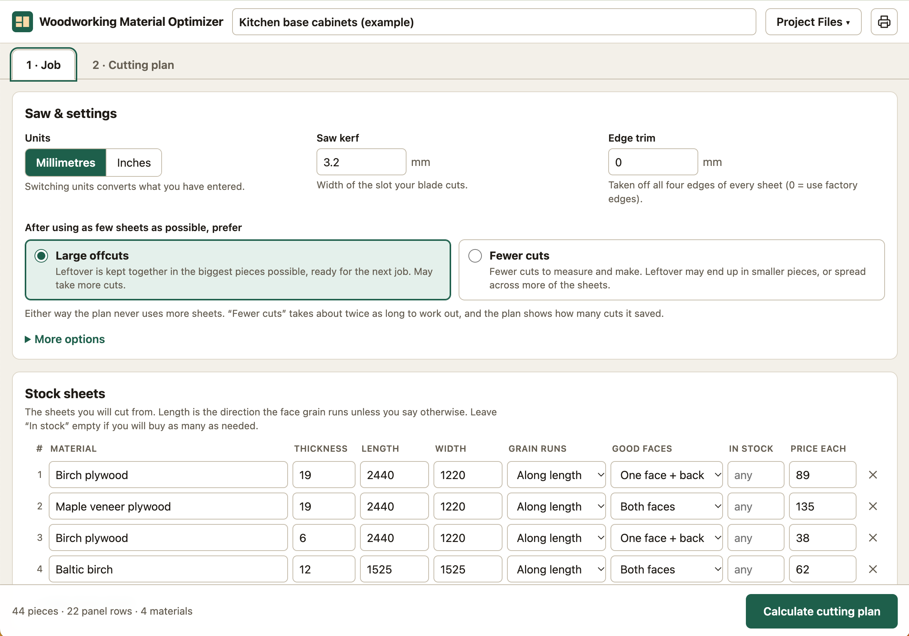
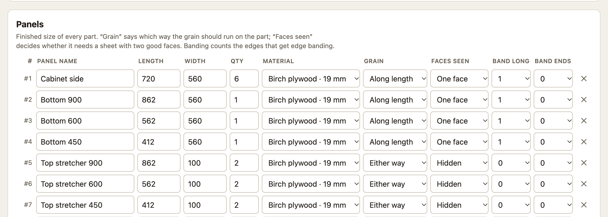
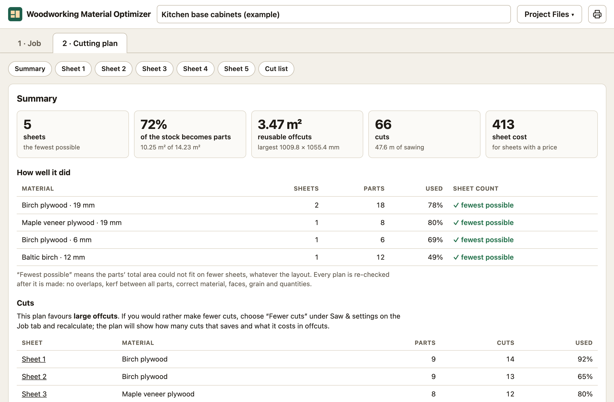
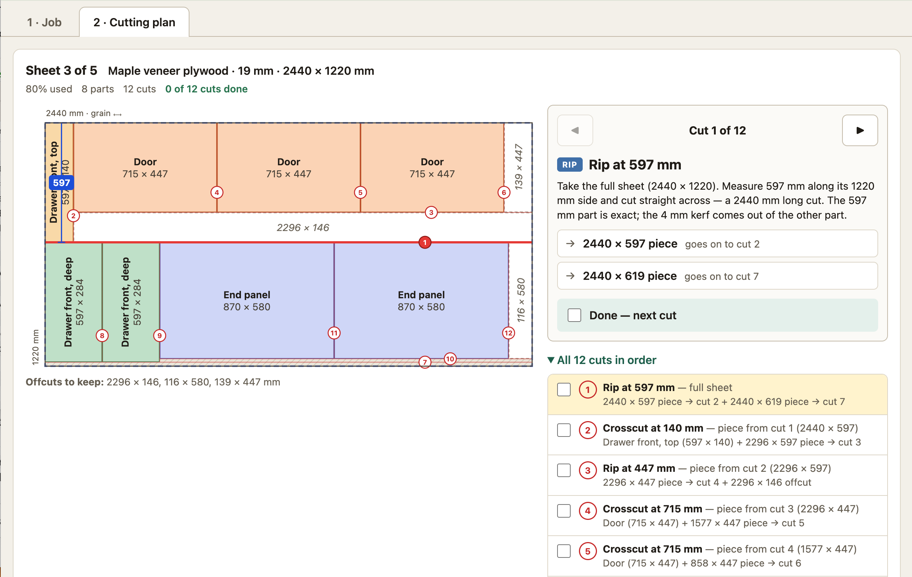

# Woodworking Material Optimizer

Give it your project plans and your sheet material, and it will tell you how to cut them from the fewest sheets possible.

I built it for my own upcoming cabinet project, tested it against real past projects that I built, and used it as a hands-on way to learn what Anthropic's Fable 5.2 can zero-shot with a reasonable brief.

## Reflection

Overall, I am wildly impressed by what can be achieved with frontier models at this point. This exercise has made me reconsider a few pretty base assumptions, including how I choose to solve problems, the longevity of SaaS that does not rely on complex system integrations, and where the floor really is for people to build things themselves. This was an empowering experience, and I'm looking forward to doing more. Take a look at the results!

## My motivation

Most woodworking projects start with a design and a list of materials that need to be cut from rough lumber or sheet goods like plywood. From there, woodworkers need to sort out which panels go on which material, and how to cut them, ideally with the fewest sheets possible. It is easy to do badly, and very hard to do well by hand.

During a renovation a few years back, I had four different cabinet projects to do. I tried to plan the cuts by hand first and quickly learned that it was extremely hard. There were too many panels and too many ways to lay them out, and doing it for four projects was too much.

So I looked online and paid for a cut-list optimizer with a monthly subscription. I used it for a month, then needed it for one more day to tweak some dimensions, and had to buy another full month. I only do this a few times a year, so a monthly subscription is the wrong way to pay for it. I was frustrated, but it was the only way I knew to get the job done.

Now we have more tools at our fingertips, and I have two more cabinetry projects coming up. It was a good chance to try again and see what a 2026 frontier model (Fable 5.2) can do. I also still had the commercial tool's layouts for my previous projects, so I had a clean test set to compare against.

## Who it's for

Woodworkers who build cabinets, built-ins or furniture out of sheet goods like plywood, MDF and laminate, and cut them on a table saw or track saw. It's most useful for hobbyists and people who plan a few projects a year rather than something every week.

## What it does

- You enter your panels (name, size, quantity, grain, which faces show, edge banding), your sheets (material, thickness, size, good faces, how many you have, price), your saw kerf and any edge trim. It works in mm or inches, including fractions.
- It finds a layout that uses the fewest sheets, then picks between two ways of finishing the job (see below).
- It draws every sheet to scale, with each cut shown at the width of the blade.
- It gives you the cuts in order. Every cut goes edge to edge, so a table saw or track saw can make it, and the kerf is already taken out of every measurement.
- You can step through the cuts and tick them off, print one page per sheet, or open it on a phone.
- Every plan gets checked by separate code before it's shown. If a plan is wrong, the app tells you not to cut from it.

## Screenshots

These use the example job that opens with the app: kitchen base cabinets, 44 pieces in four materials.

Setting up the job: units, saw kerf, edge trim, the choice between large offcuts and fewer cuts, and the stock sheets.



Entering the panels: size, quantity, material, grain, which faces show, and edge banding.



The summary after calculating: sheets used, how much of the stock becomes parts, offcuts, cuts and cost.



One sheet's layout, with every cut numbered and the cuts listed in order. You can tick them off as you go.



## How it picks a layout

It uses the fewest sheets first. After that, you choose between two modes:

- **Large offcuts:** keeps the leftover material in big pieces you can reuse. This can take more cuts.
- **Fewer cuts:** takes the fewest saw cuts. The leftover ends up in smaller pieces.

Every layout is made of straight cuts from edge to edge, because that's what a table saw or track saw can do. Some tighter layouts need L-shaped or stopped cuts, and it skips those.

## How I use it

I do most of my designs in SketchUp and export the cut list.

1. Enter the cut list into the app on my laptop, along with my sheet sizes and saw kerf.
2. Calculate, and pick large offcuts or fewer cuts depending on the project.
3. Print the sheets and tick off each cut at the saw.
4. The phone view shows the same plan and progress, and zooms in on the piece being cut.

## Results

I ran two of my past projects through it. Both were originally planned in CutList Optimizer, and I used the same sheets and saw kerf.

| Project | Sheets: CutList Optimizer | Sheets: Woodworking Material Optimizer | Cuts: CutList Optimizer | Cuts: Woodworking Material Optimizer |
| --- | --- | --- | --- | --- |
| Stair cabinets (12 pieces) | 1 | 1 | 17 | 17 |
| Kitchen cabinets and frame (36 pieces, laminate and birch) | 5 | 5 | 55 | 54 in fewer-cuts mode, 61 in large-offcuts mode |

On the kitchen project, both tools used 5 sheets. Large-offcuts mode needed 61 cuts, six more than CutList Optimizer. Fewer-cuts mode needed 54, one fewer, and it breaks the big offcut into smaller pieces.

The full panel lists are in [docs/TEST-SET.md](docs/TEST-SET.md).

Two projects is a small sample. The optimizer can't promise the best possible layout, and it only says "fewest possible" when the area makes that certain. I also haven't timed a real build using the cut order at the saw yet.

## How I built it

I built v1 in one Claude Code session with Fable 5.2 from a single written brief. The brief covered the problem, the inputs and outputs, what good looks like and how to work. I left the algorithm, the stack and the interface up to the model, and asked for automated tests, checks in a real browser, and a final report that said what wasn't verified. Here's [the prompt](docs/prompts/01-v1-build-prompt.md).

I built the prompt with Sonnet 5.5, to optimize what I did and didn't feed Fable 5.2, so it had room to reason through the architecture and implementation details.

After the build, I read through the reports and commits, and ran my past projects through it as a test set to check performance. I then did a bit of UX tweaking to make it clearer and more intuitive, and added a second approach to optimization: instead of optimizing for material used, it can also optimize for the fewest number of cuts. That used a [second prompt](docs/prompts/02-fewer-cuts-prompt.md).

It ended up with an optimizer, a layer that checks every plan, and 77 automated tests. The details are in [docs/TECHNICAL.md](docs/TECHNICAL.md).

## Run it

You need [Node.js](https://nodejs.org) 18 or newer.

```bash
npm start
```

Open `http://localhost:5173`. It loads an example three-cabinet kitchen. Press Calculate cutting plan to see it work.

- To keep it on your computer only, run `HOST=127.0.0.1 npm start`. By default other devices on your Wi-Fi can reach it, which is how the phone view works. It has no password.
- To run it with no server, double-click `cabinet-optimizer.html`. It's the whole app in one file and only saves in that browser.
- Tests: `npm test`

Everything runs on your computer. You don't need an account or an internet connection, and it doesn't cost anything.

## More

- [Technical documentation](docs/TECHNICAL.md)
- [Test set](docs/TEST-SET.md)
- [Prompts](docs/prompts/)

## Check the plan before you cut

This is a one-person project for my own use, with no guarantees. Look over a plan before you cut expensive material.

## License

[MIT](LICENSE)
